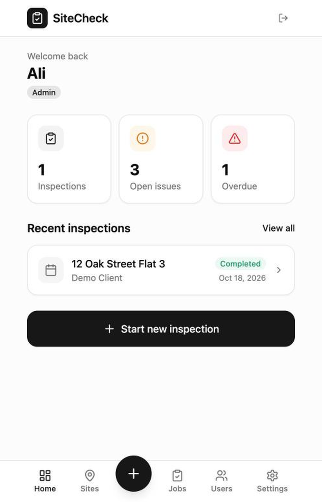
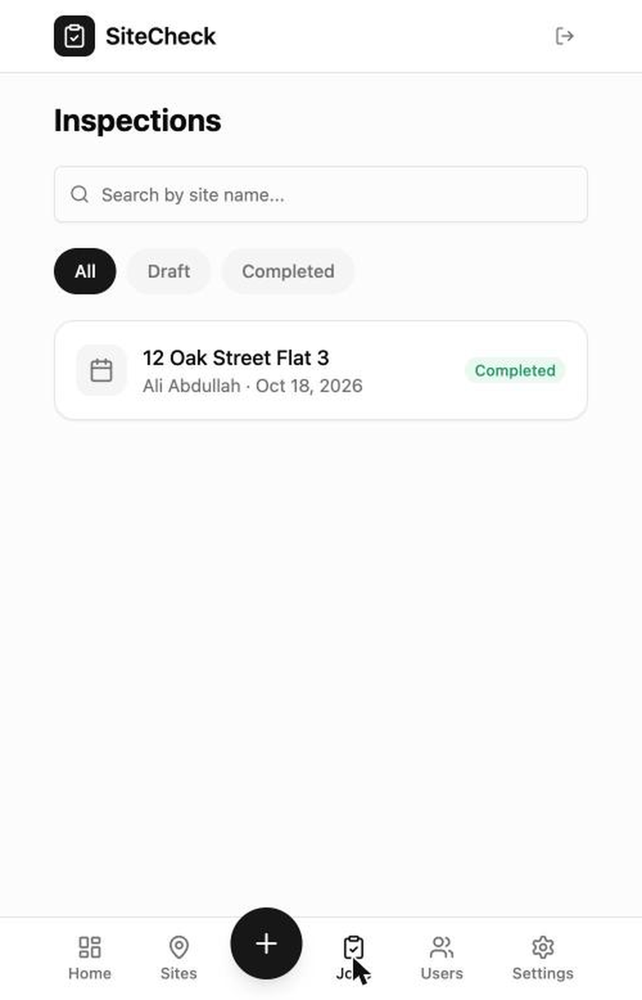
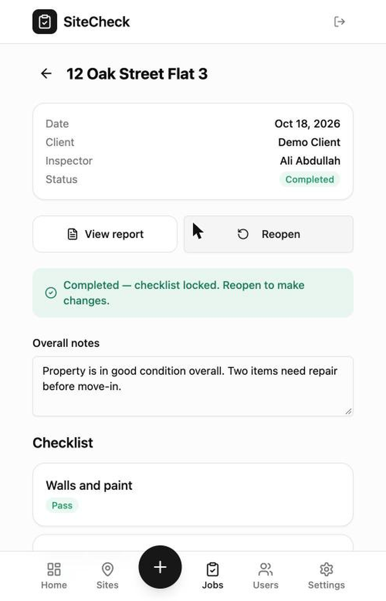
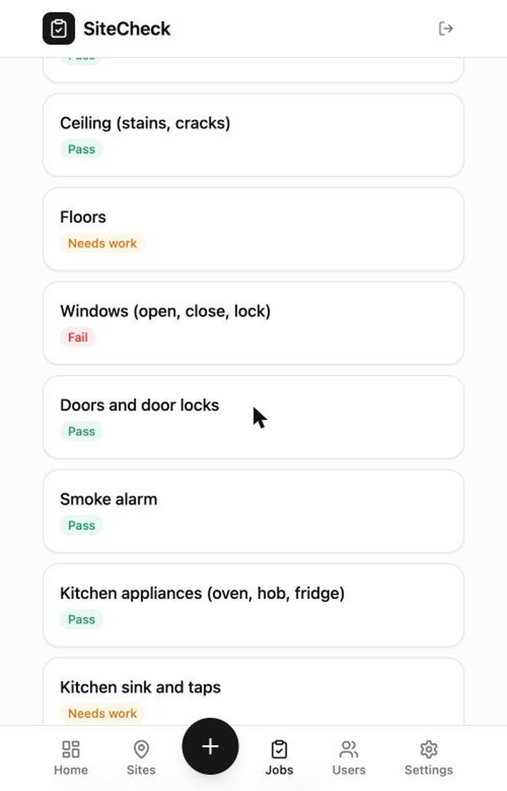
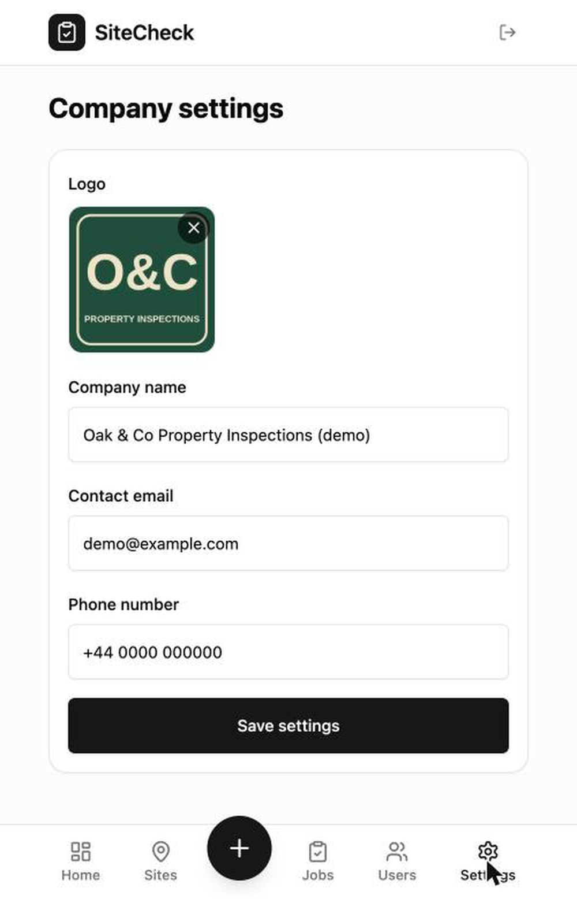
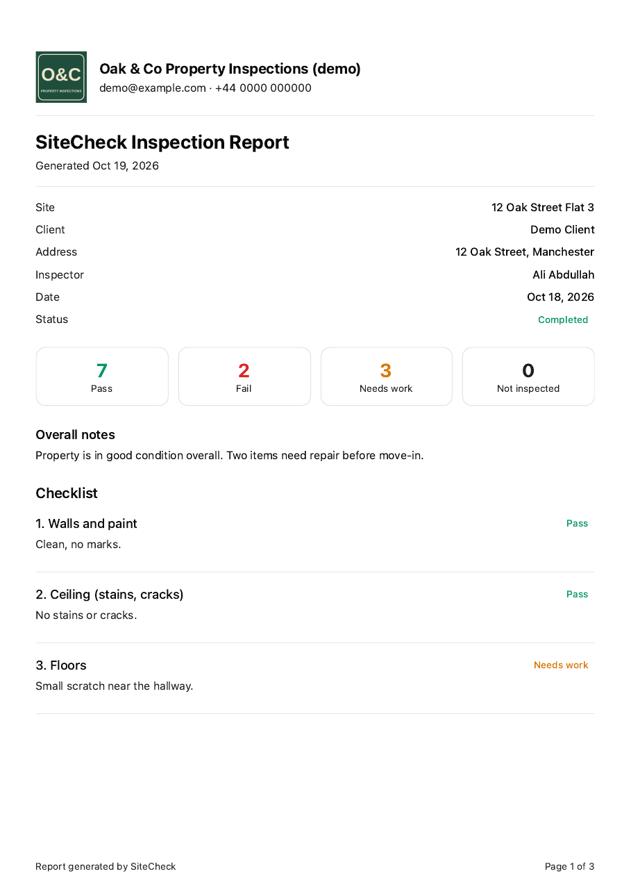
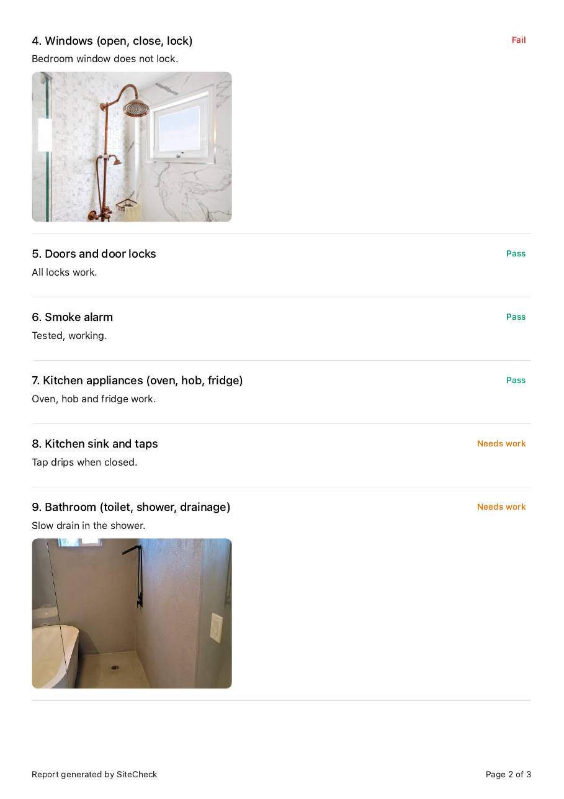
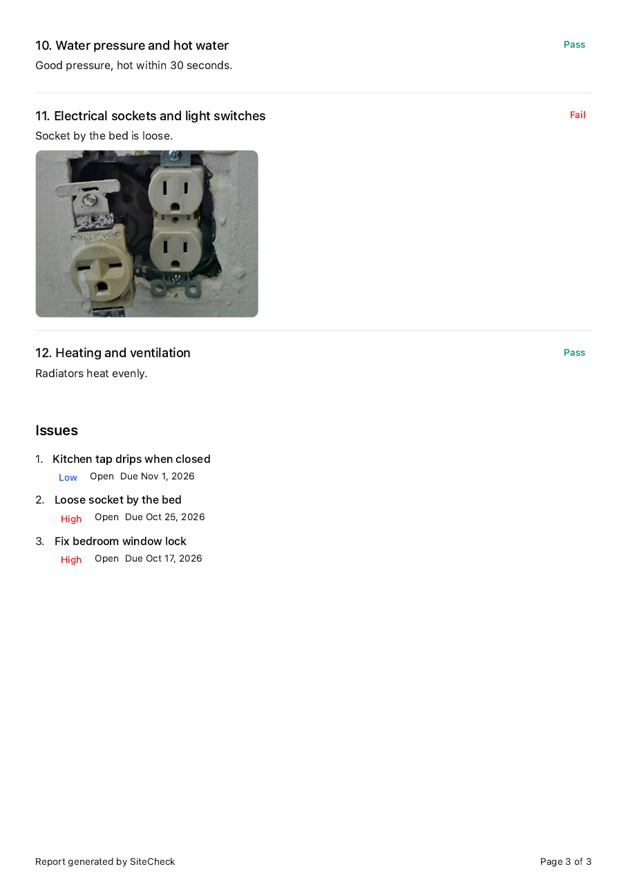

# SiteCheck

A mobile-friendly inspection app for small property and site inspection businesses. Inspectors fill in a checklist with notes and photos on their phone, and the admin gets a clean, printable client report.

**Live demo:** https://fuzzy-site-check-flow.base44.app
(Sign up with your own email to try it. Demo data only.)

## The problem

Small inspectors keep notes in WhatsApp and on paper, then spend hours turning them into a report. SiteCheck keeps everything in one place and produces the report with one tap.

## Features

- Email login with two roles: Inspector and Admin
- Sites, and inspections with an automatic 12-item checklist
- Pass / Fail / Needs work, notes, and photos from the phone camera
- Issues with priority and due dates, and an overdue count on the dashboard
- Printable client report with company logo and contact details, summary, overall notes, photos and issue list
- Inspectors see only their own inspections; admins see everything and manage users
- Search and filter, delete with confirmation, and completed inspections lock until an admin reopens them

## App screens

## Sample report

## How it was built

Built with Base44 (an AI app builder) from a written specification, then tested by hand. Testing included a second-account check that inspectors cannot open other users' inspections or reports, even by typing the address. The prompts I used are in [prompts.md](prompts.md).

## Notes

- The sample company, client, address and photos are made-up demo data.
- Inspection photos are stored with public links so they render in printed reports.

## Android app

An Android version of SiteCheck wraps the live web app in a native shell. It supports camera and gallery photo upload, printing the report to PDF, an offline screen and the back button.

- Android project: https://github.com/alab2296/sitecheck-android
- Download the APK: https://github.com/alab2296/sitecheck-android/releases/tag/v1.0
